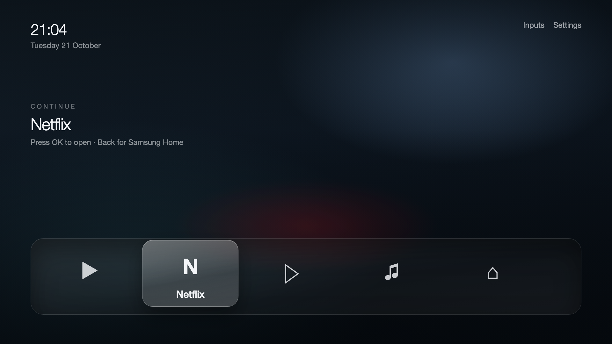

# CleanMySamsungTv

A field guide to replacing Samsung's Smart Hub with a launcher you own — and to
doing it without losing the TV.

This is the single document for the project. It records exactly what was done on
one TV, what worked, what failed and why, and what is still untested. It is
written to be forked, adapted and corrected.

> **Read the safety model before the Home-button section.** Installing an app is
> reversible with one command. Changing which app the Home button opens is not
> the same kind of operation, and on this model it may not be possible at all.

---

## 1. The TV this was built on

| | |
| --- | --- |
| Model | `UA65AU8000UXKE` |
| Platform | `21_NIKEL_UHD_BASIC` — 2021 Crystal UHD, 65" |
| OS | Tizen 6.0 |
| Region | KE |
| DUID | `SHCEPZPTODCY6` |
| Firmware string | not reported by `/api/v2/` (`Unknown`); read it on the TV under *Support → About This TV* |
| Developer mode | enabled, Host PC IP set |
| sdb | 4.2.36, TV on `192.168.100.35:26101` |
| Tizen Studio | web-cli 6.1 (CLI only, no IDE, no emulator) |
| TV extension | `TV-SAMSUNG-Public 10.0.0` |
| Certificate | Samsung profile `peregrine-samsung`, DUID-bound |
| Installed app | `tvunlock01.Peregrine` |

Samsung's [TV Model Groups](https://developer.samsung.com/smarttv/develop/specifications/tv-model-groups.html)
table puts this set in the 2021 block: **Tizen 6.0, TV Extension 6.0 or higher**.
It is not too old for the docs; the spec tables go back to Tizen 2.3 (2015).

### This is not a Frame

The TV answers the question itself:

~~~json
"modelName": "UA65AU8000UXKE",
"FrameTVSupport": "false"
~~~

CleanFrame was built on a **QA55LS03DAWXXY / LS03D** — a 2024 Frame on Tizen 9.0,
32-bit ARM — so its model-specific parts do not describe this set:

| From CleanFrame | Applies here? |
| --- | --- |
| Web-app launcher, `getAppsInfo`, `launch`, focus model, packaging | **Yes** — these are generic Tizen TV APIs |
| App list filtering and pre-baked glass materials | **Yes**, as technique |
| Art Mode (`org.tizen.art-app`) | **No** — no Art Mode, no art store, no matte panel |
| Native Home helper | **No** — model/firmware-specific and needs .NET; this set is Tizen 6.0 |
| `required_version="6.5"` | **No** — this set is 6.0, so cap it at 3.0 or 6.0 |
| Hard-coded streaming app ids | **No** — those depend on region and what is installed; discover them at runtime |
| Its Home-escape and Art destinations | **No** — they point at Frame behaviours |

Design a launcher that checks for optional destinations instead of assuming
them: if `getAppsInfo()` contains the Art app, show the button, otherwise hide
it. The same launcher then works on a Frame later without a rebuild.

## 2. What works today

- [x] Developer mode, sdb, package install and launch
- [x] A signed app built from this repo, installed and running
- [x] Full remote control over the secure WebSocket channel
- [x] A repeatable build loop of three commands
- [x] A launcher UI, **Clean Home** (`tvunlock02.Launcher`), installed as an ordinary app
- [ ] Home-button replacement (deliberately not attempted)
- [ ] Backup/restore of Home settings (blocked on the same capability)

## 3. Access: the part that is supposed to be easy

### 3.1 Developer mode

`Apps → App Settings` (or focus the Apps panel) → type **`12345`** → *Developer
mode: On* → **Host PC IP** = your computer's LAN address → reboot.

Two things cost hours here:

- **There is no visible menu.** Developer mode is a hidden code, not a setting.
  On a 2021 SolarCell remote, press `123` to raise the numeric keypad first.
- **The keypad is broken on the AU8000 family.** The on-screen keyboard often
  will not appear or will not accept digits. This is documented upstream on
  `UN55AU8000B` — the US sibling of this set. Workarounds: a USB keyboard, a
  Bluetooth keyboard, or the SmartThings virtual remote's numeric pad. This set
  was eventually enabled **through the SmartThings app**.

Confirm it took without touching the TV:

~~~bash
curl -s http://TV_IP:8001/api/v2/ | python3 -c "import json,sys; d=json.load(sys.stdin)['device']; print(d['developerMode'], d['developerIP'])"
# 1 192.168.100.24
~~~

`developerMode: 1` and `developerIP` equal to your machine's IP means it worked.
Port `26101` opens as a consequence.

### 3.2 sdb

~~~bash
sdb connect TV_IP:26101
sdb devices
# 192.168.100.35:26101   device   UA65AU8000UXKE
~~~

On this TV, `sdb shell` returns **nothing**, even for `echo hi`. The shell is
restricted on retail firmware. That matters later: it means the Home-button
helper from CleanFrame has no obvious way in, and it means you cannot inspect
the TV by shell. File transfer (`sdb push`/`pull`) and `sdb install` still work.

### 3.3 Tizen Studio without the IDE

The full installer is 1.6 GB. The CLI package is 280 MB and has everything
needed for web apps:

~~~bash
curl -LO https://download.tizen.org/sdk/Installer/tizen-studio_6.1/web-cli_Tizen_Studio_6.1_macos-64.bin
chmod +x web-cli_Tizen_Studio_6.1_macos-64.bin
./web-cli_Tizen_Studio_6.1_macos-64.bin --accept-license --no-java-check ~/tizen-studio
~~~

Then install the TV packages from the repositories Tizen Studio already knows:

~~~bash
~/tizen-studio/package-manager/package-manager-cli.bin install --accept-license --no-java-check \
  Certificate-Manager cert-add-on TV-SAMSUNG-Public \
  TV-SAMSUNG-Public-WebAppDevelopment TV-SAMSUNG-Extension-Tools \
  TV-SAMSUNG-Extension-Resources
~~~

Two installer traps:

- **The bundled JDK copy can fail** with `Killed: 9` during extraction. The JDK
  itself lands in `~/tizen-studio/jdk`; link it where the package manager looks:
  ~~~bash
  ln -s ~/tizen-studio/jdk ~/.package-manager/jdk
  ~~~
- **The emulator package prompts for a password** to install Intel HAXM, an x86
  driver that cannot work on Apple Silicon. Killing that prompt lets the run
  finish; skip the emulator entirely. It cannot validate signing or installation
  anyway, and Samsung's own docs warn its web engine differs from the TV's.

### 3.4 The certificate is not optional

Tizen will not install an unsigned package, and a Tizen-signed package is not
enough: Samsung TVs validate the **distributor certificate against the TV's
DUID**. The default `tizen-distributor-signer` has no DUID and expired in 2022.

Use **Certificate Manager** (installed with the TV packages): `+ → Samsung → TV →
profile name → author certificate (Samsung account sign-in) → distributor
certificate (privilege *Public*, add the TV's DUID)`.

Read the DUID with:

~~~bash
sdb shell 0 duid        # SHCEPZPTODCY6
~~~

or on the TV: `Menu → Support → Contact Samsung → Unique Device Identifier`.

Back up `~/SamsungCertificate/<profile>/` and its password. Future updates must
be signed with the same author certificate or the TV treats them as a different
app.

### 3.5 The build loop

~~~bash
tizen package -t wgt -s peregrine-samsung -o build -- apps/peregrine-tv
tizen install -n build/Peregrine.wgt
tizen run -p tvunlock01.Peregrine
~~~

Ten seconds, no store, no review.

Two failures that look like success but are not:

| Symptom | Cause |
| --- | --- |
| `sdb install` pushes, exits 0, nothing appears | On this TV `sdb install` only transfers. Use `tizen install`, which performs and reports the install. |
| `install failed[118, -19], reason: Parsing error` | The package id must be **10 characters**. `package="tvUnlock"` fails; `package="tvunlock01"` installs. |
| install fails with no reason at all | The `.wgt` path contains a space. The package is named after `<name>` in config.xml, so "Clean Home.wgt" must be copied to a space-free filename before `tizen install`. |

## 4. The remote channel: 8001 lies, 8002 works

Independent of the launcher, this TV refuses the plain WebSocket and accepts
only TLS:

| Channel | Result |
| --- | --- |
| `ws://TV:8001` | `ms.channel.unauthorized` in 0.01 s, every client name, no prompt |
| `wss://TV:8002` | connects, token issued, `KEY_HOME` accepted |

Two independent clients behaved identically, so this is firmware policy, not a
client bug. The bridge stores one token per TV; the working record needs
`port: 8002` and `secure: true`. The token lives at
`~/.samsung_tv_remote/token_<slug>`.

The bridge's old error text ("auto-denied this device") described a per-device
denial when the real condition was the wrong port. If you maintain a client,
fall back from 8001 to 8002 on `ms.channel.unauthorized` before reporting
anything.

## 5. Designing the launcher

The full brief — layout options, focus rules, motion tokens, type scale, the
config contract and the performance budget — is in
[LAUNCHER-DESIGN.md](LAUNCHER-DESIGN.md).

### 5.0 The app list is 393 entries

On this set, `getAppsInfo()` returns **393** entries and marks **205** visible.
The rest are hotel-mode components, ad players, telemetry agents, test builds
and duplicate wrappers. A launcher that renders the raw list is unusable, and
one that filters by id shape drops Netflix (whose id is
`org.tizen.netflix-app`).

The working design is **curation with an escape hatch**: a short allowlist of
real apps (17 here), a *Show all* tile at the end of the grid, and a documented
catalog. See [app-catalog.md](app-catalog.md).

### 5.1 What the TV actually exposes

A Tizen TV web app is a fullscreen Chromium page. These are the public APIs a
launcher needs — this is the same surface CleanFrame uses in production.

| Need | API | Privilege |
| --- | --- | --- |
| List installed apps | `tizen.application.getAppsInfo()` | `application.info` |
| Launch an app | `tizen.application.launch(appId)` | `application.launch` |
| Native settings | launch `com.samsung.tv.coba.setting` | `application.launch` |
| Samsung Home / sources | launch `com.samsung.tv.csfs` | `application.launch` |
| Art Mode | `launchAppControl` → `org.tizen.art-app` | `application.launch` |
| Remote keys | DOM `keydown`, Tizen key codes | `tv.inputdevice` |

Manifest essentials:

~~~xml
<widget xmlns="http://www.w3.org/ns/widgets" xmlns:tizen="http://tizen.org/ns/widgets"
        version="0.1.0" viewmodes="maximized">
  <tizen:application id="tvunlock01.Launcher" package="tvunlock01" required_version="3.0"/>
  <content src="index.html"/>
  <icon src="icon.png"/>
  <name>My Home</name>
  <tizen:profile name="tv"/>
  <tizen:privilege name="http://tizen.org/privilege/application.launch"/>
  <tizen:privilege name="http://tizen.org/privilege/application.info"/>
  <tizen:privilege name="http://tizen.org/privilege/tv.inputdevice"/>
  <tizen:setting screen-orientation="landscape" context-menu="disable"
                 background-support="disable" encryption="disable"
                 install-location="auto" hwkey-event="enable"/>
</widget>
~~~

`required_version` must not exceed the TV's Tizen version. 6.0 is the ceiling
here; 3.0 is a safe floor.

### 5.2 Showing all apps, without showing the plumbing

`getAppsInfo()` returns hundreds of entries — background services, account
helpers, per-region shims. A launcher has to filter. CleanFrame's approach,
worth copying: allow known package ids, keep entries that look like consumer
apps (10-character package id), then drop anything whose name matches
`service|worker|plugin|preview|promotion|launcher|test|sdk|daemon` or whose id
is on an internal deny-list. Keep the raw list available behind a "show hidden
apps" toggle so a wrong filter is recoverable without a rebuild.

~~~js
tizen.application.getAppsInfo(function (list) {
  var app = list.filter(function (a) {
    if (!a.name) return false;
    if (/^(?:[A-Za-z0-9]{10})\.[A-Za-z0-9_-]+$/.test(a.id) === false) return false;
    if (/(?:service|worker|preview|promotion|plugin|launcher|test|sdk|daemon)/i
        .test(a.name + " " + a.id)) return false;
    return true;
  });
  render(app);
}, function (err) { showError(err); });
~~~

### 5.3 Native settings and Samsung's own screens

There is no public API for "open Picture settings on the HDMI 2 page". What
exists, and what CleanFrame does in production, is launch the native apps:

| Destination | App id |
| --- | --- |
| All Settings | `com.samsung.tv.coba.setting` |
| Samsung Home / sources | `com.samsung.tv.csfs` |
| Art Mode | `org.tizen.art-app` (app control, `mode=fullscreen`) |

So "access all native settings" means **hand off to Samsung's settings app**,
not reimplement it. That is also the safe design: Samsung keeps ownership of
picture, sound, network, support and service menus, and your launcher cannot
break them.

Input switching is the same story: the source picker is part of Samsung's UI;
there is no public web API to switch HDMI directly.

### 5.4 Focus, remote, and performance

- Handle `keydown` for 37–40 and 13; leave 10009 (BACK) to the platform.
- Move focus in two dimensions; do not let Left/Right wrap across rows, which is
  the single most common "cheap UI" tell.
- Design at 1920×1080 and scale. Do not attempt 4K.
- **Pre-render** blur/glass into images. Live `backdrop-filter` on a 2021 SoC is
  what makes these launchers feel slow; CleanFrame's author fixed exactly this
  by baking the materials.
- Keep the runtime ES5-ish. The TV browser is old Chromium: no `aspect-ratio`,
  no `inset`, no `:has()`.

### 5.5 Borrowed design language

tv-vibehack's launcher and Apple TV's home screen share the ideas worth taking:
a dark field, a dock that lifts on focus, a top shelf that names the focused app
in large type, one shared focus highlight rather than per-tile borders, and an
ambient glow tinted from the app's own artwork. None of that needs platform
features; it is CSS and a focus model.

### 5.4b Quick controls, and what they cannot do

The launcher's rail offers Wi-Fi, Inputs and Settings. Checked on this TV:

| Probe | Result |
| --- | --- |
| `typeof b2bapis` | `undefined` — no B2B input control |
| `tizen.systeminfo` | present, read-only; `NETWORK.networkType` is `WIFI` |
| Chromium | 76 |

So a third-party app **cannot** toggle the Wi-Fi radio or select HDMI 1/2/3. The
rail shows Wi-Fi state and hands off to `com.samsung.tv.coba.setting.networksettings`
and `com.samsung.tv.coba.source`. Anything closer needs an IR blaster or the
host bridge sending remote keys, and even then `KEY_HDMI` only cycles.

### 5.5 Performance rules for a TV web app

A TV web engine is not a desktop browser. One full-stage paint costs 80–200 ms
here, so a single accidental paint per keypress turns 60 fps into 5 fps. The
rules, the measured anti-patterns (glow gradient, per-tile focus class, subtitle
writes), the working focus recipe and a pre-ship checklist are in
[performance.md](performance.md).

Short version: focus may change **only** `transform` and `opacity` on promoted
layers; one floating highlight; pre-render text that changes on focus; cache
`getAppsInfo`; profile on the TV, never the desktop browser.

### 5.6 Now Playing (Spotify only)

Tizen 6.0 gives third-party apps no media session, so a native-style now-playing
widget cannot read the TV's playback. The workaround is Spotify Connect: a local
service talks to Spotify's Web API and the launcher renders the card and controls.
Setup, endpoints and limits are in [spotify.md](spotify.md).

## 6. The Home button: the part that is not an app

Installing a launcher does **not** make it Home. The Home button still opens
Samsung's Smart Hub until something changes the system's Home routing.

### 6.1 How CleanFrame does it

From [its native-home helper](https://github.com/nthnclrk/CleanFrame/tree/main/scripts/native-home):

1. It pushes a small .NET assembly and a shell script over sdb.
2. It executes them **as Samsung's SDK user, UID 901**, not root, using a
   crafted package name passed to the installer
   (`0 appinstall tpk …` with a command substitution in the name). The script
   calls back to the host over `/dev/tcp`, so output can be read.
3. The helper calls `app_operation_set_current_app` for
   `http://tizen.org/appcontrol/operation/main` and writes vconf:

| Key | Meaning |
| --- | --- |
| `db/appfw/home_appid` | which app Home opens |
| `db/appfw/startup_appid` | which app starts at boot |
| `db/appfw/booting_appid_backup` | the boot fallback |
| `db/first_screen/type` | first-screen mode |
| `db/menu/smart_hub/ontvsetting/auto_start` | Smart Hub autostart |

4. It refuses to run on other firmware, refuses root, refuses if the current
   values differ from the saved baseline, and restores immediately if apply
   fails. `restore` writes the exact original values back.

That is a good design. Copy its *shape*: read, guard, apply once, read back,
verify physically, restore on doubt.

### 6.2 Why it probably does not transfer to this TV

- It depends on `/usr/bin/dotnet` and a .NET runtime on the TV. The reference
  set runs Tizen 9.0; this one runs **Tizen 6.0**, where a .NET runtime is
  unlikely to exist. Without it the helper cannot execute.
- It depends on `sdb shell` accepting the crafted `appinstall` command. This
  TV's shell returns nothing at all, so even the transport is unproven here.
- The native Home operation lives in `libcapi-appfw-app-operation-tv.so`, which
  may not be present or may behave differently in 6.0.

A 6.0 port would mean writing a **static ARMv7 native binary** instead of .NET,
and getting it to run despite Unauthorized Execution Prevention — which is the
territory [chris-ritsen/samsung-tv-root](https://github.com/chris-ritsen/samsung-tv-root)
documents, and that repo's payloads target a QN90B and QN90F, not this set.

### 6.3 Read-only inspection, before anything else

If you want to know whether the path exists on your set, inspect — do not write:

~~~bash
sdb shell 0 "id; uname -m; cat /etc/tizen-release"
sdb shell 0 "ls -d /usr/share/dotnet/shared/Microsoft.NETCore.App/*"
sdb shell 0 "vconftool get db/appfw/home_appid"
sdb shell 0 "vconftool get db/appfw/startup_appid"
sdb shell 0 "ls -l /usr/lib/libcapi-appfw-app-operation-tv.so.0"
~~~

On this TV those commands return empty, which is itself the answer: the
transport is not available, so **do not attempt the change**. Revisit only after
a read-only probe returns real values and a saved baseline.

### 6.4 The safe alternative

Run the launcher as an ordinary app and get to it without touching Home:

- open it from the app row, or
- let the remote launch it over the working 8002 channel, or
- enable *Autorun Last App* (`Settings → General → Smart Features`) so a cold
  boot lands back in your launcher when it was the last app used.

You lose the Home button. You keep every Samsung feature, and uninstalling the
app returns the TV to exactly its previous behaviour.

## 7. Safety model

### 7.1 Three tiers of change

| Tier | Example | Blast radius | Undo |
| --- | --- | --- | --- |
| 0 | install / launch / uninstall a wgt | none outside the app | `tizen uninstall -p <id>` |
| 1 | launcher preferences in `localStorage` | that app only | clear app data |
| 2 | vconf Home/startup keys | the TV's boot and Home behaviour | exact-value restore, *if* you can still execute commands |

Tier 0 and 1 are safe to iterate on all day. Tier 2 is a different activity.

### 7.2 What actually bricks a TV

- Editing the **service menu** (picture/sound calibration, model settings).
- Flashing or modifying firmware, or writing to read-only partitions.
- Rooting without a tested recovery path.
- Tier 2 without a saved baseline and without a way back in.

Installing a signed app does none of these. The realistic worst case for Tier 0
is an app that fails to launch — recoverable by uninstalling it, and by pressing
Home to get back to Smart Hub.

### 7.3 Guardrails to build in

- Model and firmware guard before any Tier 2 command; refuse anything else.
- Refuse root. The reference helper does, and it is right.
- Refuse if current vconf values differ from the baseline — someone else changed
  something, so the baseline is no longer the truth.
- Apply once, read back, compare, then verify **physically**: open Netflix,
  press Home, confirm where you land. Then power-cycle and confirm again.
- Restore before uninstalling the launcher; an uninstalled Home target can leave
  the TV pointing at nothing.
- Keep the helper and baseline off the TV and out of git.

## 8. Backup before you touch anything

### 8.1 What to capture

| Item | Where | Why |
| --- | --- | --- |
| Model + firmware | `/api/v2/`, TV menu, `/etc/prd_info.ini` | guards, and knowing what changed |
| DUID | `sdb shell 0 duid` | certificate binding |
| Author certificate + password | `~/SamsungCertificate/<profile>/` | required to update the app later |
| Distributor certificate | same | reinstall on the same TV |
| Home/startup vconf values | five keys in §6.1 | exact rollback |
| Installed app list | `getAppsInfo()` dump from the launcher | what you had before |
| Bridge token + registry | `~/.samsung_tv_remote/` | remote control |
| Launcher preferences | app `localStorage` | your layout |

### 8.2 The minimum safe backup today

Tier 0 needs almost nothing: the certificate folder and the source. Copy them
somewhere that is not the TV and not the repo:

~~~bash
cp -R ~/SamsungCertificate/peregrine-samsung ~/Backups/samsung-cert-$(date +%F)
cp -R ~/.samsung_tv_remote ~/Backups/tv-remote-$(date +%F)
~~~

Tier 2 needs the vconf values **read successfully and stored as JSON** before
any write:

~~~json
{
  "tv": "UA65AU8000UXKE",
  "firmware": "unknown",
  "duid": "SHCEPZPTODCY6",
  "captured": "2026-10-21T02:00:00Z",
  "home_appid": "...",
  "startup_appid": "...",
  "booting_appid_backup": "...",
  "first_screen_type": "...",
  "auto_start": "..."
}
~~~

If any value comes back empty, stop. An empty baseline is indistinguishable from
"no value" and a restore would write nothing while looking successful.

### 8.3 Verify the backup

Read every key twice, from two separate sessions, and compare. Then read it a
third time after a reboot. A backup you have not read back is a hope.

## 9. One-command restore

The target is a single command that returns the TV to stock behaviour. Split by
tier, because only one half is guaranteed:

~~~bash
# Tier 0 — always works, no device state required
tizen uninstall -p tvunlock01.Launcher

# Tier 2 — only if a verified baseline exists and the transport still works
./restore-home.sh original.json
~~~

`restore-home.sh` should:

1. Refuse if the model or firmware differs from the baseline.
2. Read the five keys and print current vs original.
3. Write the original values back, one at a time.
4. Read them back and diff.
5. Report success or refuse; never claim success from the write alone.

And the runbook around it:

1. Restore Home **before** uninstalling the launcher.
2. Reboot at the wall, not standby.
3. Press Home from an app; it must land on Samsung's Smart Hub.
4. Power on from cold; it must reach the same place it did before.
5. Only then uninstall.

## 10. Rebuild from scratch

~~~bash
# 1. TV
#    Apps → App Settings → 12345 → Developer mode On → Host PC IP → reboot
#    (SolarCell: press 123 for the keypad; USB keyboard if the keypad fails)

# 2. Verify access
curl -s http://TV_IP:8001/api/v2/ | python3 -m json.tool | grep -E 'modelName|developerMode|developerIP'
sdb connect TV_IP:26101 && sdb devices

# 3. SDK
curl -LO https://download.tizen.org/sdk/Installer/tizen-studio_6.1/web-cli_Tizen_Studio_6.1_macos-64.bin
chmod +x web-cli_Tizen_Studio_6.1_macos-64.bin
./web-cli_Tizen_Studio_6.1_macos-64.bin --accept-license --no-java-check ~/tizen-studio
ln -sf ~/tizen-studio/jdk ~/.package-manager/jdk

# 4. TV packages (kill the HAXM password prompt if it appears)
~/tizen-studio/package-manager/package-manager-cli.bin install --accept-license --no-java-check \
  Certificate-Manager cert-add-on TV-SAMSUNG-Public \
  TV-SAMSUNG-Public-WebAppDevelopment TV-SAMSUNG-Extension-Tools \
  TV-SAMSUNG-Extension-Resources

# 5. Certificate: Certificate Manager → + → Samsung → TV → distributor Public + DUID
sdb shell 0 duid

# 6. Project
tizen create web-project -n MyHome -p tv-6.0 -t WebBasicapplication -- apps/
# 10-character package id in config.xml, then your files
tizen package -t wgt -s <profile> -o build -- apps/MyHome
tizen install -n build/MyHome.wgt
tizen run -p <packageid>.MyHome
~~~

## 11. Roadmap

- [ ] Launcher UI: app grid, dock, focus model, clock — browser preview first
- [ ] App list with hidden-app escape hatch
- [ ] Settings and Samsung Home hand-offs
- [ ] Install-time config: which apps, which order
- [ ] Remote-control integration: launch the launcher over the 8002 channel
- [ ] Autorun Last App instructions, tested on a cold boot
- [ ] Read-only native probe, documented per firmware
- [ ] Tier 2 Home takeover, only if a probe succeeds on a specific set
- [ ] One-command restore, tested by restoring a deliberately changed value
- [ ] Firmware-update recovery notes

## 12. Sources

- [CleanFrame](https://github.com/nthnclrk/CleanFrame) — the reference
  implementation, its setup guide and its native-home helper
- [couchroot S90D notes](https://github.com/splitcipher/couchroot/blob/83906b468836869933012da03a4018fb339462b3/docs/devices/s90d/README.md) —
  the native Home method on another model
- [Samsung Certificate Manager](https://developer.samsung.com/smarttv/develop/getting-started/setting-up-sdk/creating-certificates.html)
- [Samsung TV Model Groups](https://developer.samsung.com/smarttv/develop/specifications/tv-model-groups.html)
- [Samsung: connecting to the TV](https://developer.samsung.com/smarttv/develop/getting-started/using-sdk/tv-device.html)
- [chris-ritsen/samsung-tv-root](https://github.com/chris-ritsen/samsung-tv-root) —
  SDB package-name injection and what root actually costs
- [cleanyourtv](https://github.com/Gathin23/cleanyourtv) (formerly tv-vibehack) —
  Android-only, but the design language, theme overlay format and the
  reversible-by-default discipline are worth stealing
- [TizenBrew](https://github.com/reisxd/TizenBrew) — sideloading without living
  in Tizen Studio

## 13. The honest summary

You can replace the screen you look at, and you can do it without risking the
TV. You cannot, on this model, replace the button that gets you there without an
undocumented native change that Tizen 6.0 probably cannot run.

Build the launcher. Install it. Launch it. Keep Samsung's Home intact. If a
read-only probe later proves the native path on your exact firmware, the helper
design is documented above — with a baseline, a guard, and a restore — and it is
still the riskiest thing in this repository.
