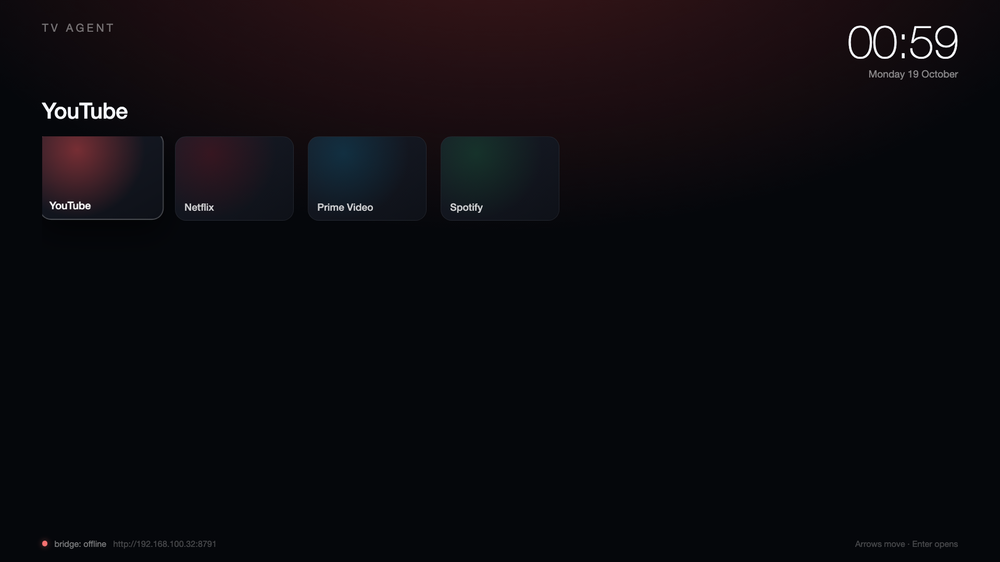
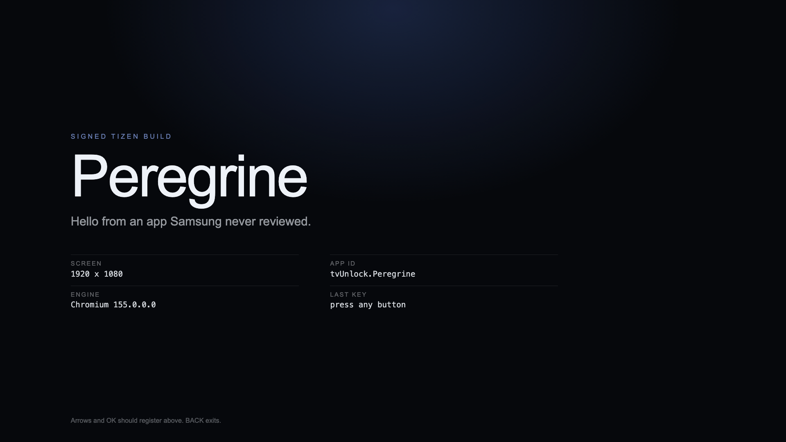
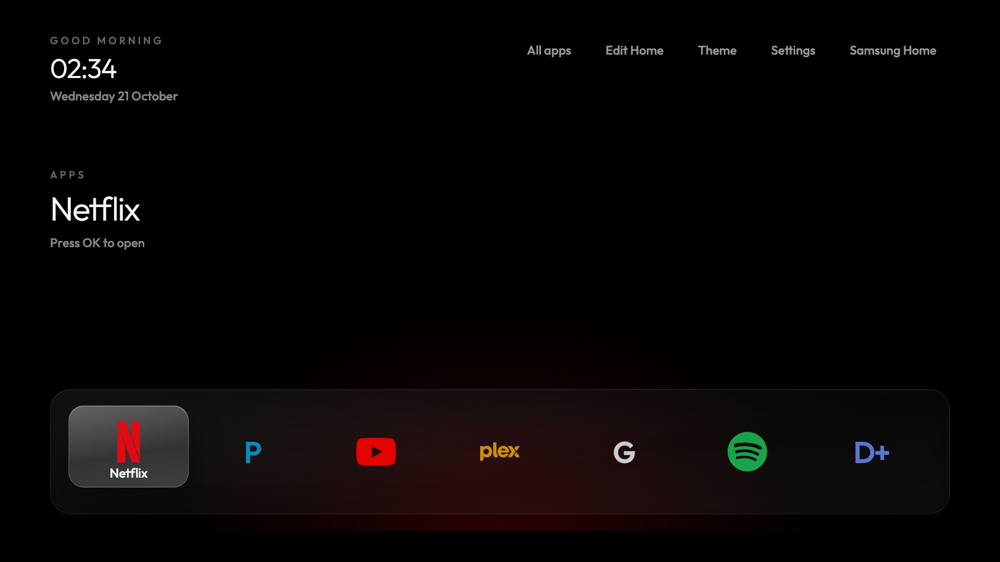

# Samsung TV Unlock

Turning a Samsung Tizen TV into a platform you own: your launcher, your apps,
pushed from this machine, controlled from your network. No store submission, no
review queue.

> **The guide:** [CLEANMYSAMSUNGTV.md](CLEANMYSAMSUNGTV.md) is the single
> document for this project — every verified step, the launcher architecture,
> the Home-button reality, and the safety/backup/restore model. This README is
> the working log; that file is the one to fork.
>
> **The design:** [LAUNCHER-DESIGN.md](LAUNCHER-DESIGN.md) — layouts, focus
> model, motion and type specs, plus a rendered [Shelf concept](design/shelf.html).

| | |
| --- | --- |
| Model | `UA65AU8000UXKE` |
| Platform | `21_NIKEL_UHD_BASIC` — 2021 Crystal UHD, 65" |
| OS | Tizen 6.0 |
| Region | KE, wireless |
| Developer mode | **off** |
| Local IP control (port 8001) | **refused** — see [docs/findings.md](docs/findings.md) |
| UPnP renderer (port 9197) | works: volume, mute, transport, plus WoL for power-on |

It is **not** a Q60A/Q70A/Q80A. It is the entry-level 2021 AU8000. That changes
the root story, not the app story.

## The one thing to understand first

The remote-control channel looked dead for days: plain port 8001 refused every
client name in 0.01s with no prompt. It was not a denial — this firmware only
accepts the **TLS channel on 8002**. See
[Remote channel — resolved](#remote-channel--resolved). Controls now work.

But you do not need that channel to get what you actually asked for. The TV will
run **your** web apps if you enable developer mode once, and a TV-side app can
talk to your computer over plain HTTP. That inverts the direction of control:
instead of the bridge reaching into the TV, the TV app reaches out to the bridge.

That is the architecture in this repo: [agent/](agent/) is a Tizen web app that
renders your launcher, launches apps, and polls the bridge for commands.



## What is achievable, honestly

| Goal | Verdict | How |
| --- | --- | --- |
| Install your own apps, no store | **Yes** | developer mode + signed `.wgt` via `sdb` |
| Update them in seconds | **Yes** | `tools/deploy.py` build + install |
| Your own launcher UI | **Yes** | [apps/Launcher](apps/Launcher) ("Clean Home"), installed and running |
| Launch apps from your computer | **Yes** | bridge keys, or the launcher's own app grid |
| Full key injection while another app is open | **Yes** | paired on `wss://:8002`, all keys |
| Boot straight into your launcher | **Yes** | *Autorun Last App*, if the TV exposes it |
| Replace Smart Hub as the real Home screen | **No** | no launcher indirection in Tizen firmware |
| Uninstall preinstalled apps | **No** | no package manager access without root |
| Kill ads and telemetry | **Partly** | DNS sinkhole on the router + Privacy settings |
| Root | **Unlikely** | no public exploit for AU8000; see below |

## Remote channel — resolved

**21 Oct 2026:** this firmware accepts only `wss://<tv>:8002`; plain 8001
refuses instantly for every client name. The bridge is now paired and reporting
`keys: true`. Details in [docs/findings.md](docs/findings.md). The steps below
are kept as history; they were not the cause.

## Still worth trying for the remote channel

Do these in order; each takes a minute and they are cheap.

1. **Power-cycle the TV.** Unplug for 10 seconds. A refused handshake can leave
   a transient block that survives standby.
2. **On the TV:** `Settings → General → External Device Manager → Device
   Connection Manager`. Delete every entry, then set `Access Notification` to
   `First Time Only`. If an `IP Remote` toggle exists anywhere in that menu,
   turn it on.
3. **Retry with a fresh name:**
   ```bash
   python3 samsung_tv_remote.py --host 192.168.100.26 --name "Unlock 1" key home
   ```
   A prompt on the TV means it is fixed. A 0.00s refusal means the TV gates the
   channel regardless of configuration — stop here and use the agent path.
4. **Sanity check with Samsung's own app.** Pair SmartThings. If SmartThings works
   while third-party clients do not, the TV is allowing its own cloud-relayed
   client and not the local channel; that is a firmware decision, not a setting.

Samsung's own caveat is in their docs: *"This function may not be supported
depending on the model or geographical area."* KE firmware is a plausible
candidate for exactly that.

## Root: what the repos actually say

- [chris-ritsen/samsung-tv-root](https://github.com/chris-ritsen/samsung-tv-root)
  works on a **QN90B** (2022, Tizen 6.5, Linux 5.4.77) and a **QN90F** (2025,
  Tizen 9). Each needs a model-specific kernel exploit: `/dev/sdp_pqe_fdet` on
  the QN90B, Mali-G510 `CVE-2025-0072` on the QN90F. Neither is a 2021
  AU8000, and the payloads are tied to kernel and driver layouts.
- It does ship a **model-independent SDB foothold** (`SVE-2025-50109`, a package
  name injection that yields uid 901). That is the only piece plausibly worth
  testing on your set, and it needs developer mode first. It is also volatile:
  root is reacquired from the host after every boot, nothing persists on the TV.
- [The Calif write-up](https://blog.calif.io/p/codex-hacked-a-samsung-tv) is a
  different, older target (Linux 4.1.10, `KantS2`), exploited through
  world-writable `ntksys`/`ntkhdma` nodes. Same lesson: the foothold was
  *code execution in the browser app* — which is exactly what installing your own
  web app gives you, without the kernel bug.

Root would buy you input remapping, overlays, HDMI capture, and native app
control. It would not buy you a replacement Home screen, and on this model it
probably does not exist. Do not chase it until the app path is working.

## Bluetooth / remote firmware

Not the useful target. The 2021 remote is BLE and bonded to the TV with keys you
do not have; sniffing it with a Nordic sniffer shows HID-ish reports but not a
way to impersonate the remote without the bond. The interesting input code lives
in the TV, and reading it requires root anyway.

If you want full keys independent of the TV's auth, an **IR blaster** (Broadlink
RM4, or an ESP32 with an IR LED) is the pragmatic answer: local, no pairing,
works while any app is open. Test power/volume first to confirm the AU8000's IR
receiver responds.

## Peregrine

[apps/peregrine/](apps/peregrine/) is a deliberately tiny signed Tizen app: a
hello world that reports the screen size, the Chromium version and the last
remote key. It exists to prove build → sign → `sdb install` → launch before
anything more ambitious. See [its packaging runbook](apps/peregrine/PACKAGING.md).



It is installed and running on the TV as `tvunlock01.Peregrine`. This TV is
`21TV_STANDARD1` / Tizen 6.0 in Samsung's model-group table, so it needs
**TV Extension 6.0 or higher** — not the oldest tooling. No launcher is being
built.

The build loop, after the one-time certificate:

```bash
tizen package -t wgt -s peregrine-samsung -o build -- apps/peregrine-tv
tizen install -n build/Peregrine.wgt
tizen run -p tvunlock01.Peregrine
```

## Clean Home (the launcher)

[apps/Launcher](apps/Launcher) is a real launcher, installed as an ordinary app:

| | |
| --- | --- |
| App id | `tvunlock02.Launcher` |
| Label | Clean Home |
| Lists apps | `tizen.application.getAppsInfo()` |
| Launches | `tizen.application.launch()` |
| Hand-offs | `com.samsung.tv.coba.setting`, `com.samsung.tv.csfs` |
| Home button | **unchanged** — this is Tier 0 |



Dock order: **YouTube, Netflix, Prime Video, DStv, Spotify, Plex, Internet,
gear (Settings)**. Eight tiles at 190px. All apps grid on `Down`, controls
top-right, Back returns one level. Press `Up` then **Edit Home** to choose the dock: OK adds or
removes, a green dot marks membership, Back saves. The choice lives in
`localStorage`.

Samsung's `getAppsInfo` does not expose the Smart Hub app-bar order, so the
bookmarked list cannot be read — it has to be recreated once in the editor. The
first-run default mirrors the common app-bar order (Netflix, Prime Video,
YouTube, Plex, Gallery, Spotify).

Known brands use bundled marks (Netflix, YouTube, Spotify, Plex, Apple TV, plus
coloured P and D+) because the `iconPath` returned by the TV is not always the
icon the TV itself displays. Every other app uses `iconPath`, with its initial
as a fallback.

The look follows cleanyourtv's Android launcher: pure black, Outfit Light for
the hero, 16–20px tile corners, frosted pills, and an ambient glow in the
focused app's colour. Press `Up` → **Theme** to cycle **Obsidian**, **Aurora**
and **Six columns**; the choice persists.

**Now playing.** A Spotify Connect card and control panel, fed by a local
service rather than Tizen (the TV exposes no media session). See
[docs/spotify.md](docs/spotify.md).

**Performance.** [docs/performance.md](docs/performance.md) is a full guide: ten
rules, measured anti-patterns, the working focus recipe, a profiling method and a
pre-ship checklist. On this TV focus went from 5–12 fps to 62 fps, and the
4-second app scan is skipped on cached launches.

**Quick rail.** Below the dock: Wi-Fi status, Inputs and Settings. Tizen exposes
neither the Wi-Fi radio nor input selection to third-party apps — `b2bapis` is
undefined on this set and `systeminfo` is read-only — so each pill is a one-press
hand-off to Samsung's own screen rather than an in-place toggle.

**All apps is curated.** The TV reports **393** entries and marks **205** visible;
Clean Home shows **17** of them and puts the rest behind a *Show all apps (205)*
tile at the end of the grid. The full map is
[docs/app-catalog.md](docs/app-catalog.md) — every id, what it appears to do, and
whether it is shown. Curation is presentation only; nothing is uninstalled.

No vconf, no Home reassignment, no root. Uninstall with
`tizen uninstall -p tvunlock02.Launcher` and nothing else changes.

```bash
tools/deploy-launcher.sh        # package, install, launch
```

The script exists because of two traps: `tizen package -o` resolves relative
paths against the CLI's own directory, and `tizen install` fails silently when
the `.wgt` path contains a space — which it does, because the package is named
after `<name>` in config.xml ("Clean Home.wgt").

## Layout

```
apps/peregrine/   hello-world Tizen app + packaging runbook (start here)
agent/            Tizen TV web app: launcher UI, app launching, command polling
  config.xml      Tizen manifest (privileges, tv-samsung profile, hwkey events)
  index.html      shell and styles
  main.js         grid, focus handling, bridge polling, tizen.application.launch
tools/
  deploy.py       build the .wgt, find sdb, install to the TV
  bridge_stub.py  tiny HTTP bridge so the agent can be tested today
docs/
  findings.md     raw evidence from the live probe
```

## Getting started

### 1. Developer mode (one time, on the TV)

`Apps → App Settings` (or focus the Apps panel) → enter `12345` → `Developer
Mode: On` → `Host PC IP` = this machine's LAN address (currently
`192.168.100.32`) → reboot the TV.

Verify:

```bash
sdb connect 192.168.100.26:26101
sdb devices
```

On retail firmware a plain `sdb shell` may print `closed` and exit. That is
expected and does not prevent installing packages.

### 2. Signing (one time, on this machine)

Tizen will not install an unsigned package. You need one Samsung author
certificate, created free with a Samsung account:

- **Tizen Studio** → Certificate Manager → new Samsung certificate (author +
  distributor) → save the profile (e.g. `samsung`), then package the app once
  from the IDE; **or**
- CLI: install Tizen Studio's CLI tools, create a profile with
  `tizen certificate`, then `tizen package -t wgt -s samsung -- agent/`.

After this, every rebuild is a one-liner. The certificate expires; renew yearly.

### 3. Build, install, run

```bash
python3 tools/deploy.py build                # writes build/agent.wgt + bridge.js
python3 tools/deploy.py install --tv 192.168.100.26
```

Then launch **TV Agent** from the TV's app row.

To try the agent without the TV, and to see the shape of the protocol:

```bash
python3 tools/bridge_stub.py --bind 0.0.0.0 --port 8791
curl -s localhost:8791/agent/config | python3 -m json.tool
curl -s -X POST localhost:8791/cmd -d '{"type":"launch","appId":"111299001912"}'
```

### 4. Boot into your launcher

`Settings → General → Smart Features → Autorun Last App` (the exact path varies
by firmware; some sets expose only *Autorun Smart Hub*). With your agent as the
last app, a power-on lands in your UI instead of Samsung's.

## Roadmap

- [ ] Confirm developer mode and get `sdb devices` listing the TV
- [ ] One-time certificate; install the agent
- [ ] Agent pulls its app list from the bridge instead of hardcoded defaults
- [ ] Bridge endpoint that runs `sdb install` — "push to TV" from a phone
- [ ] Agent reports what it launched, so the bridge can show recent/favourite
- [ ] IR blaster on the bridge for blind keys (power, volume, nav)
- [ ] Optional: test `SVE-2025-50109` preflight on this set; expect incompatible
- [ ] Network-level ad blocking: router DNS list + Privacy settings off

## Risks

- Developer mode pins `Host PC IP`; changing networks means re-entering it.
- Firmware updates can drop the certificate or developer mode. Reinstalling is
  usually enough.
- A signed package from a public tutorial may not install; you need your own
  certificate for your own builds.
- Never touch the service menu looking for "more". That is how TVs get bricked.
- Ads: blocking `acr0`/`sas.samsungcloudsolution` stops the sponsored rows but
  breaks Hulu and in-stream YouTube. Filter per-app, not globally.

## Sources

- [tv-vibehack](https://github.com/Gathin23/tv-vibehack) — ADB/Android only; its
  design language and backup/restore discipline are the portable parts
- [chris-ritsen/samsung-tv-root](https://github.com/chris-ritsen/samsung-tv-root)
- [Calif: Codex hacked a Samsung TV](https://blog.calif.io/p/codex-hacked-a-samsung-tv)
- [Synacktiv: Rooting the Samsung Q60T (Sthack 2022)](https://www.synacktiv.com/sites/default/files/2022-05/Sthack2022_Rooting_Samsung_Q60T_Smart_TV.pdf)
- [TizenBrew](https://github.com/reisxd/TizenBrew) — sideloading without Tizen Studio repeated
- [Samsung developer docs: connecting to the TV](https://developer.samsung.com/smarttv/develop/getting-started/using-sdk/tv-device.html)
