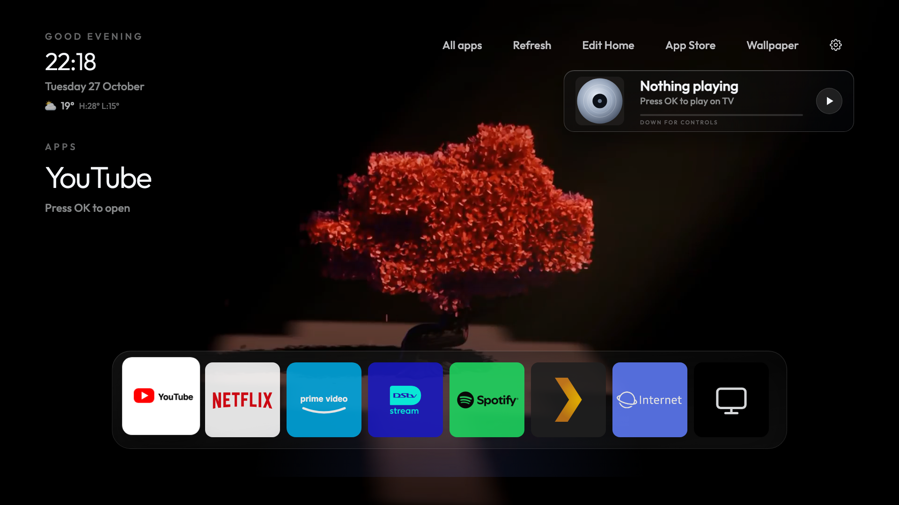
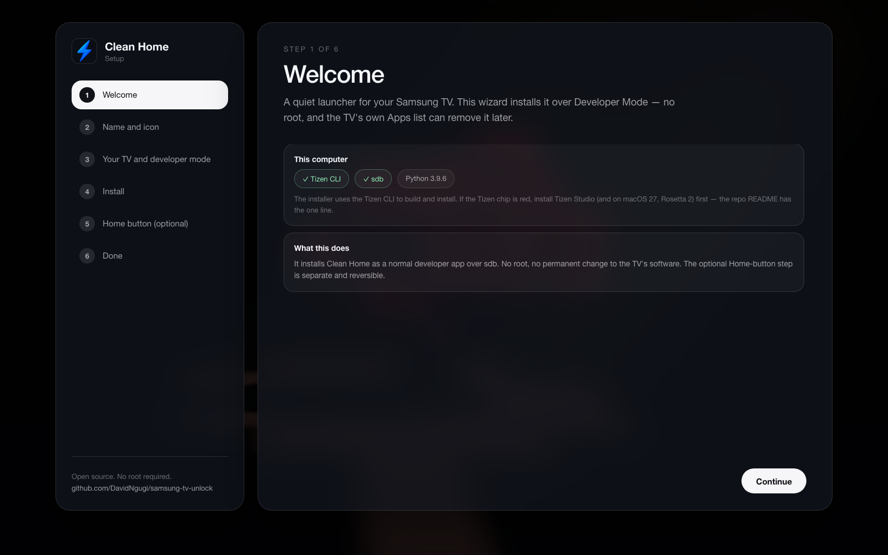

<h1 align="center">Clean Home</h1>

<em>A quiet, Apple-TV-style launcher for Samsung Tizen TVs.</em>

Sideload it in minutes, then make the <b>Home button</b> open it — no root, no store, and every step is reversible.

- Clean, Apple-TV-style launcher: app-card dock, All apps, clock + weather
- **Hidden Controls** popover: inputs, Wi-Fi, TV settings, theme, diagnostics
- Physical **Home button → Clean Home** (works on Tizen 6, no root)
- **Instant** switching (the launcher stays resident)
- Optional **Spotify now-playing** card and controls
- **Browser preview** (`tools/preview.sh`) — iterate the UI without a TV
- **Guided installer** (`python3 install.py`) — a local wizard, no CLI flags
- One-command **backup** and **restore**

---

## Step 0 — Know your TV

Open **Settings → Support → About This TV**. Write down the model and the
**Tizen version** (6.0, 6.5, 8.0, 9.0…). That version decides which extras are
possible — see the table at the bottom.

---

## Part 1 — Install the launcher (every Tizen TV)

**Step 1.** Install Tizen Studio (CLI + TV extension). One time.
    https://developer.tizen.org/development/tizen-studio/download

**Step 2.** Make a Samsung certificate for your TV (author + distributor, tied to
    your TV's DUID). One time. The certificate tools walk you through it.

**Step 3.** Enable Developer Mode on the TV:
    Home → Apps → App Settings → type **12345** → Developer Mode **On** →
    set **Host PC IP** to your computer → restart the TV.

**Step 4.** Clone and start the guided installer:

~~~bash
git clone https://github.com/DavidNgugi/samsung-tv-unlock.git
cd samsung-tv-unlock
python3 install.py
~~~

    It opens a local wizard at `http://127.0.0.1:8765` that finds your TV on the
    network, walks through Developer Mode and the certificate profile, then builds
    and installs Clean Home. It binds to localhost only.

    No wizard? The same install from the terminal:

~~~bash
tools/deploy-launcher.sh
~~~

**Step 5.** Open **Clean Home** from the TV's app list. Done — you have your
launcher.

---

## Part 2 — Home button and boot open Clean Home

On **Tizen 6** neither the Home key nor the first screen is a root setting — both
are reversible data writes.

- **Home key:** a row in `app-context.db.key_filter`
- **Boot/wake:** `db/appfw/home_appid`, `db/appfw/booting_appid_backup`, and
  `db/first_screen/type` in vconf

Follow [docs/HOME-BUTTON.md](docs/HOME-BUTTON.md), then power-cycle the TV. The
rule that matters: existing system keys can be overwritten by `sdk`; missing ones
cannot be created.

On Tizen 8/9/10 the same result uses a native setter or temporary root (see the
version table). The app install in Part 1 is identical.

---

## Part 3 — Optional: Spotify now-playing

1. Create a Spotify app at developer.spotify.com. Redirect URI:
   `http://127.0.0.1:8795/callback`
2. Run the bridge on a machine that stays on:
   `SPOTIFY_CLIENT_ID=xxx python3 tools/spotify_service.py`
3. Open `http://127.0.0.1:8795/login` once and approve.
4. Play something in the TV's Spotify app. Full setup: [docs/spotify.md](docs/spotify.md).

---

## Part 4 — Manage the dock

- **Add / remove:** Up → **Edit Home** → press **OK** on an app. A green dot
  means it's on the dock. The dock holds 9.
- **Reorder:** hold **OK** on a dock tile → Left/Right moves it → **OK** locks,
  **Back** cancels.

---

## Part 5 — Back up

~~~bash
tools/backup-tv.sh
~~~

Writes model/DUID, the app list, source, certificate, and a `RESTORE.md` to
`~/Backups/cleanmysamsungtv/<date>/`. Run it **before** changing anything.

---

## Part 6 — Undo everything (one step)

~~~bash
tools/revert.sh <TV-IP>
~~~

That single command:

- restores the stock `/opt/dbspace/.app-context.db` (Home button → Samsung Home)
- sets `db/appfw/home_appid`, `db/appfw/booting_appid_backup` and
  `db/first_screen/type` back to their stock values (TV viewer / Smart Hub)
- uninstalls Clean Home

Then **power-cycle** the TV (unplug 10 s). Flags: `--skip-uninstall` keeps the
app, `--stock-db PATH` if your stock DB isn't in `~/Backups`.

If the stock DB can't be found, the script says so and leaves the Home key
alone — restore it from your backup with `docs/HOME-BUTTON.md`.

---

## What each Tizen version can do

| Tizen | Year | Install app | Home button | Root |
| --- | --- | --- | --- | --- |
| 4.x / 5.x | 2019–20 | yes (web app) | untested | unknown |
| **6.0** | **2021 (AU8000)** | **yes** | **yes — key_filter DB write, this repo** | **no** |
| 6.5 | 2022 (QN90B) | yes | via root | yes (samsung-tv-root) |
| 8.0 | 2023 | yes | via native setter / root | yes (samsung-tv-root) |
| 9.0 / 10 | 2024–25 | yes | via native setter / root | yes (temporary root) |

Published launchers and what they need:

- [Zen TV](https://github.com/princepozo/zen-tv) — Tizen 4, a calm Apple-TV-style
  web launcher; no root. The design reference for Clean Home's dock cards,
  Controls popover and weather row.
- [CleanFrame](https://github.com/nthnclrk/CleanFrame) — Tizen 9, native .NET/NUI,
  temporary root, Home via `app_control_set_defapp` + vconf.
- [quiet-tizen](https://github.com/jss8649/quiet-tizen) — Tizen 9, .NET, temporary
  root inside the Bixby-promotion package.
- [samsung-tv-root](https://github.com/chris-ritsen/samsung-tv-root) — QN90B (6.5)
  and QN90F (9), model-specific kernel exploits.

**This repo is the Tizen 6.0 path** — the one those projects didn't document.
There is no root and no .NET helper, but the Home key is just a database row, so
the button can be taken over without root.

---

## Preview (no TV needed)

~~~bash
tools/preview.sh
~~~

Serves `apps/Launcher` at `http://127.0.0.1:8090/` and opens it in your browser.
The launcher detects the missing Tizen APIs and falls back to demo data, so you can
iterate layout, focus, wallpapers, Controls and weather without packaging.

- `PORT=9000 tools/preview.sh` — different port
- Edit `apps/Launcher/*` and refresh the browser; no `.wgt` build needed

## More

- [docs/SETUP.md](docs/SETUP.md) — the full walkthrough
- [docs/HOME-BUTTON.md](docs/HOME-BUTTON.md) — Home-key write and restore
- [docs/spotify.md](docs/spotify.md) — Spotify bridge
- [docs/performance.md](docs/performance.md) — why focus is fast and Home is instant
- [CLEANMYSAMSUNGTV.md](CLEANMYSAMSUNGTV.md) — the long-form guide and backup/restore model
